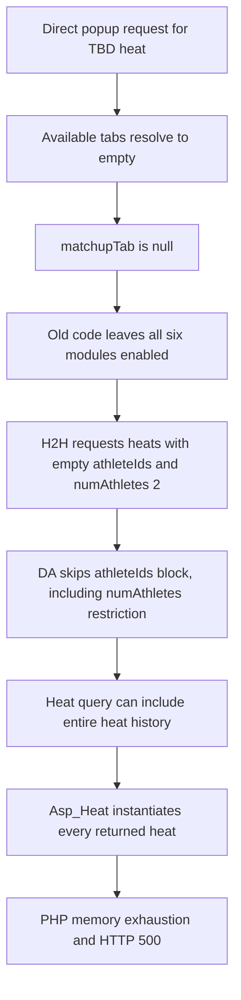

# WSL-9678 investigation — 22 October 2026

## Conclusion

The public WSL website heat-details popup can fail when a heat has no assigned athletes. The fix is merged into `wsl-web`'s `beta` branch. Its merge commit has successful CI/deployment statuses. The original faulty code is still present on `master` at inspection time. This investigation is a Jira/GitHub/source review, not a live endpoint retest or proof of the production deployment version.

## Ticket and related work

- [WSL-9678](https://wslproduct.atlassian.net/browse/WSL-9678): **Heat details popup returns 500 for heats with no athletes assigned**. High priority, Ready for QA, reporter Ahmed Magdy, assignee/developer Youssef Alaa, 2 story points. Created 20 October 2026. Sprint 2621 (9–23 October). No issue links, attachments, fix version, or comments were returned.
- [WSL-9790](https://wslproduct.atlassian.net/browse/WSL-9790): child QA subtask, To Do, assigned Max White. Description only says “QA verification for WSL-9678.”
- [Fix PR #3936](https://github.com/worldsurfleague/wsl-web/pull/3936): merged 20 October 2026 at 15:02:14 UTC into **beta**, from `bug/WSL-9678-Heat-details-popup-500-beta`.
- Fix commit `fa28f93af5c42baa86049bb41c6822a97e167e61`; merge commit `b40a64667f4810cda655dbefe65d162339d0e96b`.
- Reviewer `mmallet-ts` requested changes then approved the final revision. Inline suggestions covered explicit `is_array()` validation and removing redundant explanatory comments. CodeRabbit explicitly skipped its automatic review because the target was not the default branch; its green status is not evidence of a code review.
- A Jira text search returned other loosely matching issues; none was established as a dependency or duplicate. No `9678` PR was found in `sly-cms`; that does not prove no unrelated logging change exists there.

## Scope and observed history

This is the PHP **worldsurfleague/wsl-web** repository, not the Next.js athlete registration/Tour Manager repository `wsl-frontend`.

The Jira report describes direct requests from a scraper approximately every three minutes on 19 October, using rotating proxy IPs and Chrome/120.0.0.0. It says normal TBD heat cards are not clickable. These are the reporter's observations, not independently verified traffic findings from this investigation.

Historical evidence in Jira:

| Heat | Event ID | State / assigned athletes | Reported result |
| --- | --- | --- | --- |
| 114300 | 5114 | Over / 2 | 200 |
| 114304 | 5114 | Upcoming semifinal 1 / 0 | 500 |
| 114305 | 5114 | Upcoming semifinal 2 / 0 | 500 |
| 114943 | 5115 | Upcoming semifinal 1 / 2 | Not in 500 logs; not an explicit successful response |
| 114944 | 5115 | Upcoming semifinal 2 / 0 | 500 |

Jira's reproduction requests `https://www.worldsurfleague.com/events/2026/ct/445/meo-rip-curl-pro-portugal/results?heatId=114944&requestName=postEventWatchHeatDetailsPopup`, with `Ajax-Request: postEventWatchHeatDetailsPopup` and a cache-busting `rnd`. The route segment 445 differs from the reported heat's event ID 5115; event/heat consistency should be checked in the QA dataset. Old production heats may now have athletes, so reusing the ID alone is insufficient to prove the original precondition.

## Technical failure chain

Important correction: the query is not reliably limited to two-athlete heats. The `numAthletes` condition is nested inside the athlete filter, so both restrictions are skipped for an empty array. The PR reports **111,627 heats locally** and exhaustion of **128 MB** PHP memory. Those numbers come from the developer's PR, not a new measured run.

## Source map and implemented protections

Reviewed beta snapshot: `11927ab6cb3a62e6ff3043e6a1b77566d3259a84`.

| File / location | Role / finding |
| --- | --- |
| `common/helpers/FormatEvent2.php:1835` | `getAvailableMatchupDetailTabs()` selects available details, Career and H2H tabs. H2H requires two assigned athletes and a two-athlete heat. Career has its own condition and can be available with one athlete. The ticket's simplified statement “fewer than two always gives no tabs” is not universally true. |
| `core/website/modules/postEventWatchHeatDetailsPopup.phtml:88–110` | If no requested/default tab exists, the new `! $matchupTab` condition selects the details module set, excluding Career and H2H. It does not introduce an explicit 404 response. |
| `core/website/modules/postEventWatchHeatMatchupHeadToHead.phtml:28–36` | Returns before historical query when `count($athleteIds) < 2`. A Finals event may replace the heat with its round's first heat before this guard. |
| `common/lib/Asp/Da/Heat.php:375–379` | `getHeatIds()` returns an empty array if `athleteIds` is set and is non-array or has fewer than two items. Stops the query before construction. |
| `common/lib/Asp/Da/Heat.php:453–472` | Existing athlete-pair join and nested `numAthletes` condition explain the old broad query. |
| `common/lib/Asp/Heat.php:159–171` | `getHeats()` obtains IDs then creates an object for every result, explaining the memory cost. |
| `core/website/pages/postEventWatchHeatDetailsPopupAjax.xml` | Popup AJAX page includes the shared popup template. |
| `core/website/pages/postEventWatchHeatDetailsContentPopupAjax.xml` | Content-refresh AJAX page also includes that template; both paths need coverage. |
| `core/website/modules/postEventWatchHeatMatchupCareer.phtml` | Not changed by this PR. Has a missing-heat guard but no new fewer-than-two guard. Explicit Career requests require separate verification. |

Popup entry points appear in the heat grid, bracket, bracket-stage, Finals grid, current heats, current team heats and wavepool-hybrid modules. These are relevant UI regression areas, rather than evidence that every layout exposes a zero-athlete link.

Source links: [popup](https://github.com/worldsurfleague/wsl-web/blob/11927ab6cb3a62e6ff3043e6a1b77566d3259a84/core/website/modules/postEventWatchHeatDetailsPopup.phtml#L88), [H2H](https://github.com/worldsurfleague/wsl-web/blob/11927ab6cb3a62e6ff3043e6a1b77566d3259a84/core/website/modules/postEventWatchHeatMatchupHeadToHead.phtml#L28), [DA guard](https://github.com/worldsurfleague/wsl-web/blob/11927ab6cb3a62e6ff3043e6a1b77566d3259a84/common/lib/Asp/Da/Heat.php#L375), [tab helper](https://github.com/worldsurfleague/wsl-web/blob/11927ab6cb3a62e6ff3043e6a1b77566d3259a84/common/helpers/FormatEvent2.php#L1835).

## Release and validation evidence

- PR build-push and tests statuses are successful: [73817](https://circleci.com/gh/worldsurfleague/wsl-web/73817), [73818](https://circleci.com/gh/worldsurfleague/wsl-web/73818).
- Merge commit statuses include successful tests [73831](https://circleci.com/gh/worldsurfleague/wsl-web/73831) and web deployment [73828](https://circleci.com/gh/worldsurfleague/wsl-web/73828), plus CMS, pub/sub, cron, Varnish and Gearman jobs. These are GitHub-reported statuses; job logs and runtime commit identity were not inspected.
- `.circleci/config.yml:390` defines a beta workflow deploying after build and tests. The deployment helper passes `ENVIRONMENT` into the Helm deployment script. The exact public hostname and currently running image were not established.
- At inspected master `7513ad948757c7c1d8709c06e04360cfd596a17d`, the DA guard and null-tab fallback are absent. The merge commit and master compare as diverged (master ahead 36, behind 14). This confirms missing changes in those inspected master files; it does not independently identify what production is running.
- The PR changes exactly three files: 10 additions, 1 deletion. It adds no test file.

## Gaps and edge cases

1. No live API/browser retest, SQL tracing, PHP-memory measurements, or log verification was performed here. Keep the ticket Ready for QA until those checks pass.
2. Proposed `sly-cms` ErrorController exception logging is not part of PR #3936. The Jira claim about swallowed exceptions remains a separate observability concern.
3. Proposed Career guard and optional Varnish request limiting are not implemented in this PR.
4. The DA guard uses `isset`: `athleteIds => null` bypasses it, as does omission of the key. The known H2H path supplies an array and has its own guard, but the shared method is not a universal protection against every malformed call.
5. Arrays with two duplicate IDs, nonnumeric IDs, nonzero/sparse indexes, or more than two IDs are not validated by the new guard. Existing query code reads indexes 0 and 1. These are robustness checks, not confirmed remotely exploitable failures.
6. Unknown, explicitly supplied `matchupTab` values still skip the recognised tab-selection branches. H2H now has its own guard, but this can include unexpected modules; test it.
7. The shared DA method now deliberately returns no results for one athlete in `athleteIds`. Regression-test legitimate pair-query callers. Do not confuse this parameter with the separate singular `athleteId` or `orAthleteIds` filters.

## QA coverage to run

| Case | Expected result / evidence required |
| --- | --- |
| Upcoming CT heat, zero assigned athletes, default popup | 200 with safe details/empty content or accepted 404; no 500, PHP fatal, or broad historical query |
| Same precondition via content-refresh AJAX request | Same safe response |
| Zero athletes, explicit `h2h` | Safe response, no historical query |
| Zero athletes, explicit `career` | No 500; inspect module output and query scope |
| Zero athletes, unknown tab | No 500 or broad query |
| One assigned athlete | Safe details/Career where supported; H2H absent or returns early |
| Two assigned athletes, upcoming heat | Existing H2H/Career content and links unchanged |
| Completed two-athlete heat | Details, scores, Career and H2H work; compare known control heat 114300 if still suitable |
| Missing/unknown heat ID | Graceful empty/not-found response; no expensive query |
| Finals multi-heat round | Check the round-first-heat substitution with empty and populated draws |
| CS, wavepool/team and big-wave event layouts | Existing valid details/tab rules unchanged |
| DA unit/integration inputs | Empty, one-item and scalar athleteIds yield []; valid pair still filters; null/omitted and malformed arrays assessed against intended contract |
| Desktop and mobile UI | Valid heat popup opens/closes; TBD controls behave as designed; AJAX refresh works |
| Observability | Inspect request correlation, PHP/application logs and DB query count; do not equate a green HTTP response with proof of bounded SQL |

Use a verified QA environment with a preserved zero-athlete fixture. Avoid repeatedly replaying the expensive unfixed production request. No production load test was run for this investigation.

## Investigation artifacts

- `artifacts/WSL-9678-pr3936.json`: PR metadata, descriptions, review summaries, changed-file list and PR checks.
- Read-only beta checkout: `.local/wsl-web-9678` (sparse checkout; not the registration frontend).
- Jira and repository code were not modified; no ticket transitions or comments were made.
